# Rapport de Projet : Système Microservices E-Banking & Intégration IA

## 1. Introduction
Ce projet s'inscrit dans le cadre du développement d'une architecture logicielle moderne basée sur des **microservices**. L'objectif principal est de concevoir un système bancaire distribué, résilient, tolérant aux pannes et interconnecté, tout en intégrant des fonctionnalités avancées d'intelligence artificielle (Chatbot conversationnel).

Les principales réalisations de cette première partie comprennent :
* Le développement des services métiers (`Customer-Service` et `EBank-Service`).
* La mise en place de l'infrastructure des microservices avec l'annuaire de services (`Discovery Service` / Eureka) et la passerelle d'API (`Spring Cloud Gateway`).
* L'établissement d'une communication inter-services déclarative et sécurisée via **OpenFeign**.
* L'implémentation de la tolérance aux pannes et de la résilience à l'aide de **Resilience4J (Circuit Breaker)**.
* Les tests et la validation des API à l'aide de Postman et de l'interface interactive Swagger-UI.

---

## 2. Architecture du Projet
L'architecture globale du système repose sur un écosystème de microservices Spring Boot communiquant entre eux et gérés par une infrastructure centralisée :
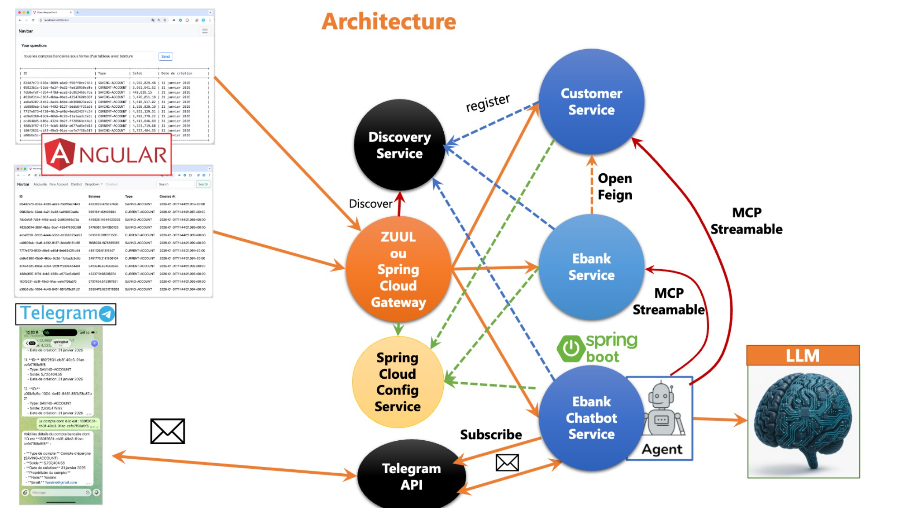
---

## 3. Implémentation et Validation des Services

### A. Discovery Service (Eureka Server)
Le serveur d'enregistrement et de découverte permet à l'ensemble des microservices de s'enregistrer dynamiquement et d'être découverts sans configuration d'adresses IP statiques.

* **Tableau de bord Eureka (Port 8761)** :
  La capture ci-dessous montre l'enregistrement réussi de tous nos services (`CUSTOMER-SERVICE`, `EBANK-SERVICE`, et `GATEWAY-SERVICE`) avec le statut **UP**.

  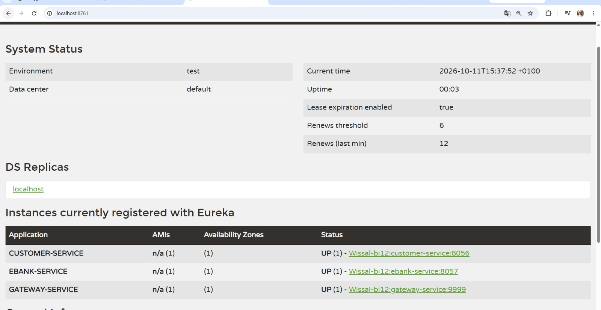
 
---

### B. Customer-Service (Port 8056)
Ce service gère les opérations CRUD relatives aux clients de la banque.

* **Liste des clients (GET /customers)** :
  Accès direct à la liste des clients enregistrés au format JSON.

  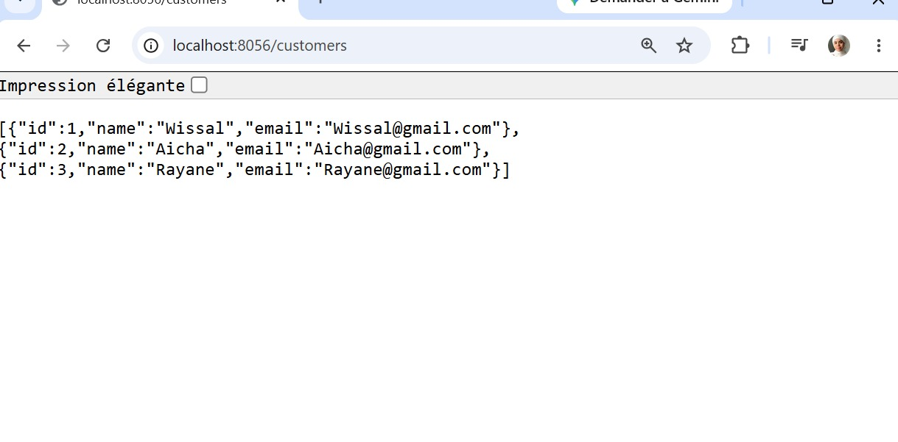

* **Recherche d'un client par ID (GET /customers/1)** :
  Récupération des détails d'un client spécifique (ex: ID 1 - Wissal).

  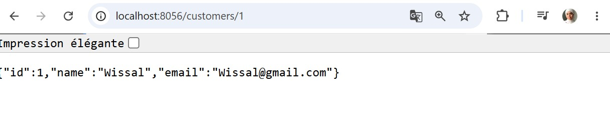

* **Tests via Swagger-UI (Customer Service)** :
    * **GET - Récupération de tous les clients via Swagger** :
      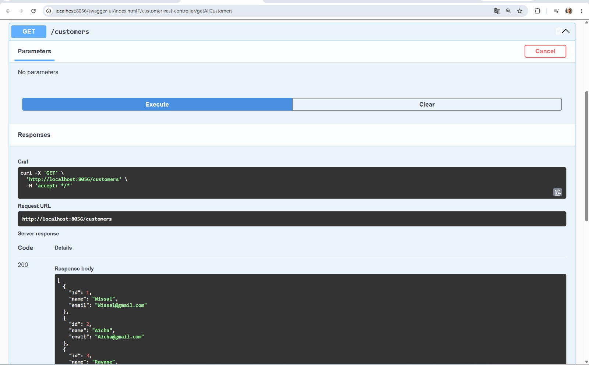

    * **POST - Ajout d'un nouveau client via Swagger** :
      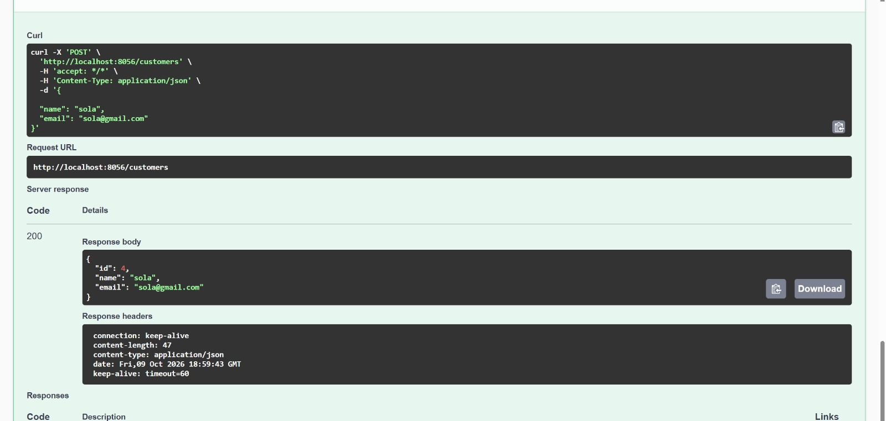

---

### C. EBank-Service & Communication OpenFeign (Port 8057)
Ce service gère les comptes bancaires et communique avec le `Customer-Service` via **OpenFeign** pour lier chaque compte à son propriétaire, tout en étant protégé par **Resilience4J** contre les pannes distantes.

* **Liste de tous les comptes bancaires (GET /accounts)** :
  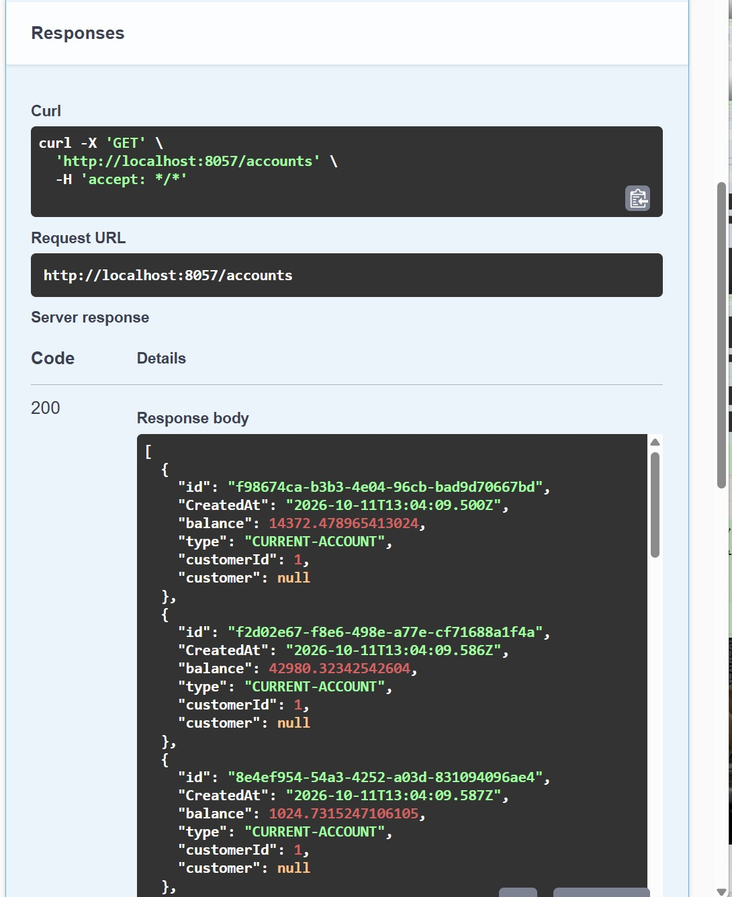

* **Création d'un compte bancaire (POST /accounts)** :
  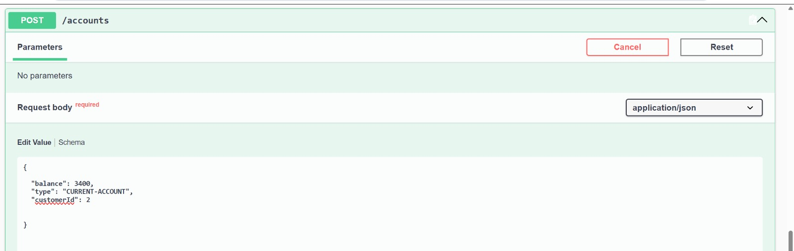

* **Recherche d'un compte par ID (GET /accounts/{id})** :
  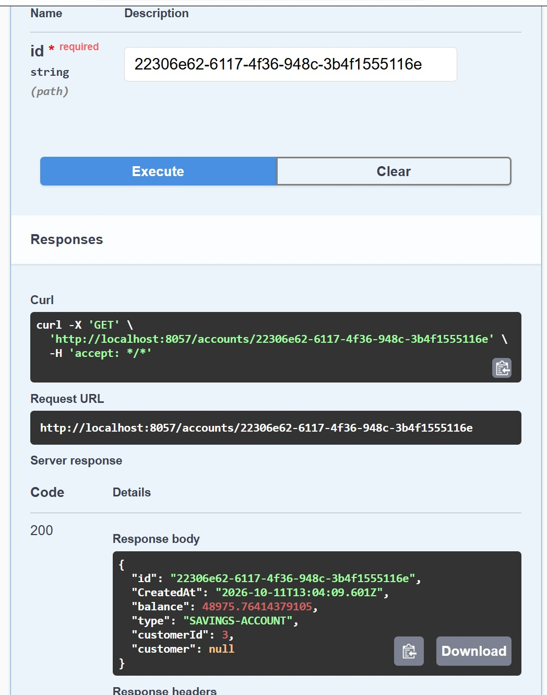

---

### D. Spring Cloud Gateway & Routage Dynamique (Port 9999)
La passerelle d'API sert de point d'entrée unique pour toutes les requêtes clients, assurant le routage dynamique vers les microservices sous-jacents enregistrés dans Eureka en utilisant leurs noms en majuscules.

* **Routage Gateway vers Customer-Service (`http://localhost:9999/CUSTOMER-SERVICE/customers`)** :
  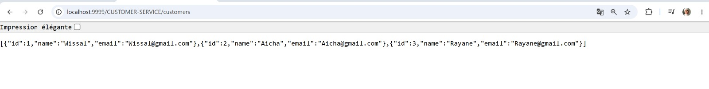

* **Routage Gateway vers EBank-Service (`http://localhost:9999/EBANK-SERVICE/accounts`)** :
  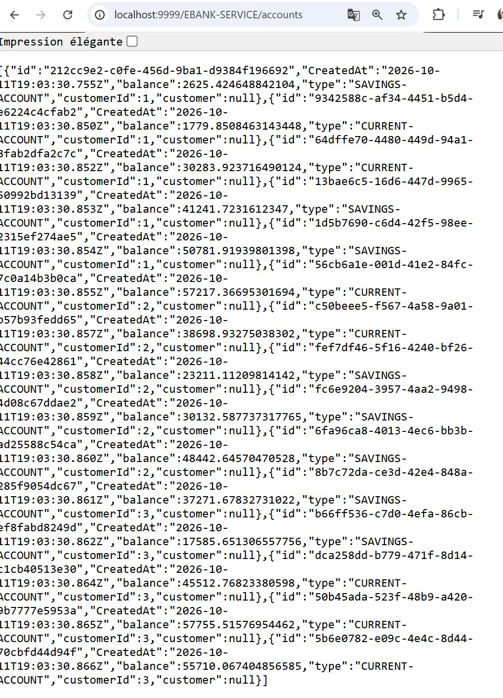

* **Routage Gateway vers un compte spécifique (`http://localhost:9999/EBANK-SERVICE/accounts/{id}`)** :
    * *Cas normal (Service client joignable)*:
      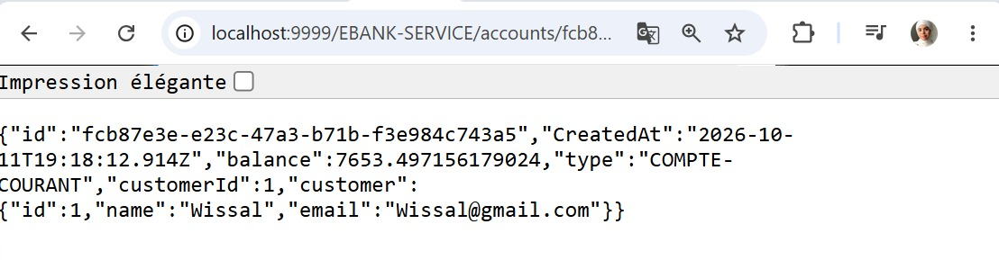
    * *Cas de tolérance aux pannes (Fallback Resilience4J)* :
      Lorsque le `Customer-Service` est injoignable, le Circuit Breaker se déclenche et renvoie gracieusement `"Not available"` au lieu de lever une erreur critique 500.
      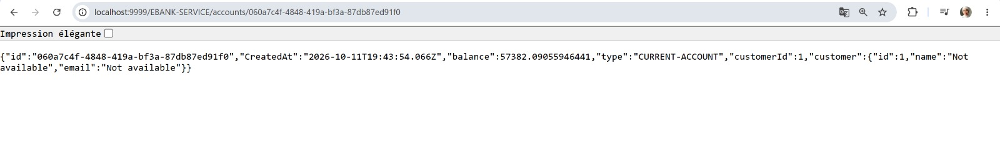

---

## 4. Conclusion
Cette première étape a permis de valider la mise en place d'une architecture microservices robuste avec Spring Boot et Spring Cloud. La communication inter-services via OpenFeign, la centralisation du routage par la Gateway et la tolérance aux pannes avec Resilience4J sont pleinement fonctionnelles.

____
## 5. Partie 2 : Implémentation de l'Agent IA, MCP et Bots Multi-Plateformes

### A. Tests Initiaux et Limite du Stateless (Sans Mémoire)
1. **Interrogation générale :** Test initial du chatbot en interrogeant l'agent sur une question ouverte (ex: *"C'est quoi Marrakech"* via l'API REST) pour valider le bon fonctionnement du modèle de langage et des réponses textuelles.

   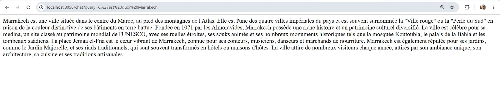

2. **Constat de l'absence de mémoire :** Par défaut, un LLM est *stateless* (sans état) et ne conserve aucun historique des requêtes précédentes. Si l'on envoie un message de salutation (`"Bonjour"`), puis que l'on se présente (`"Bonjour je m'appelle Wissal"`), et qu'ensuite on demande *"c'est quoi mon nom"*, l'agent se montre incapable de s'en souvenir.

   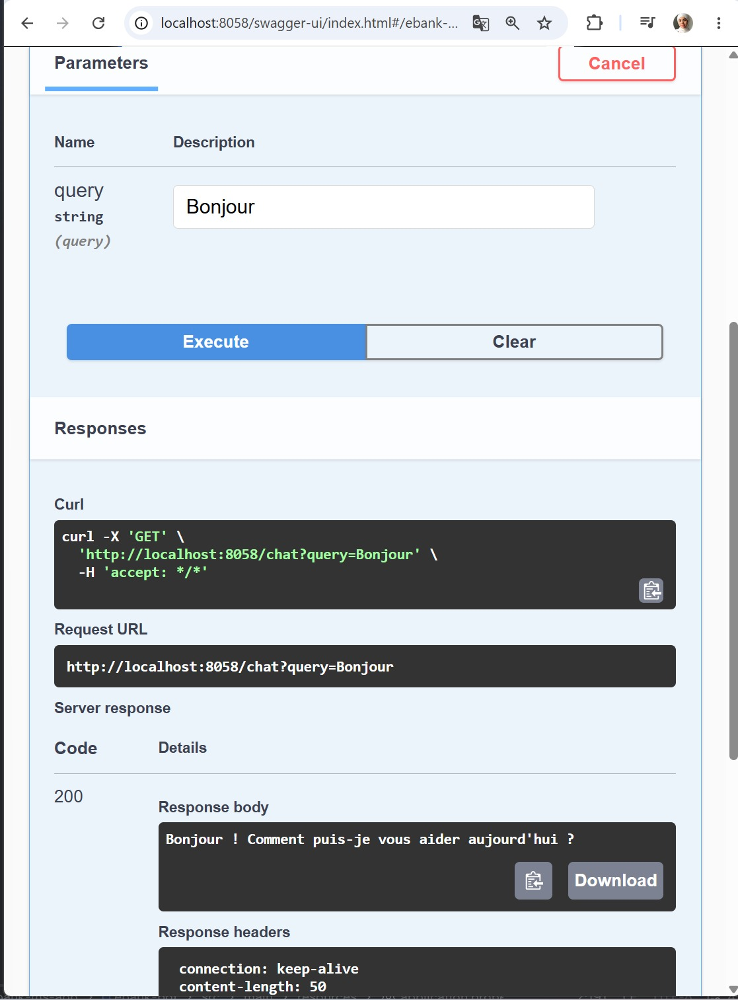
   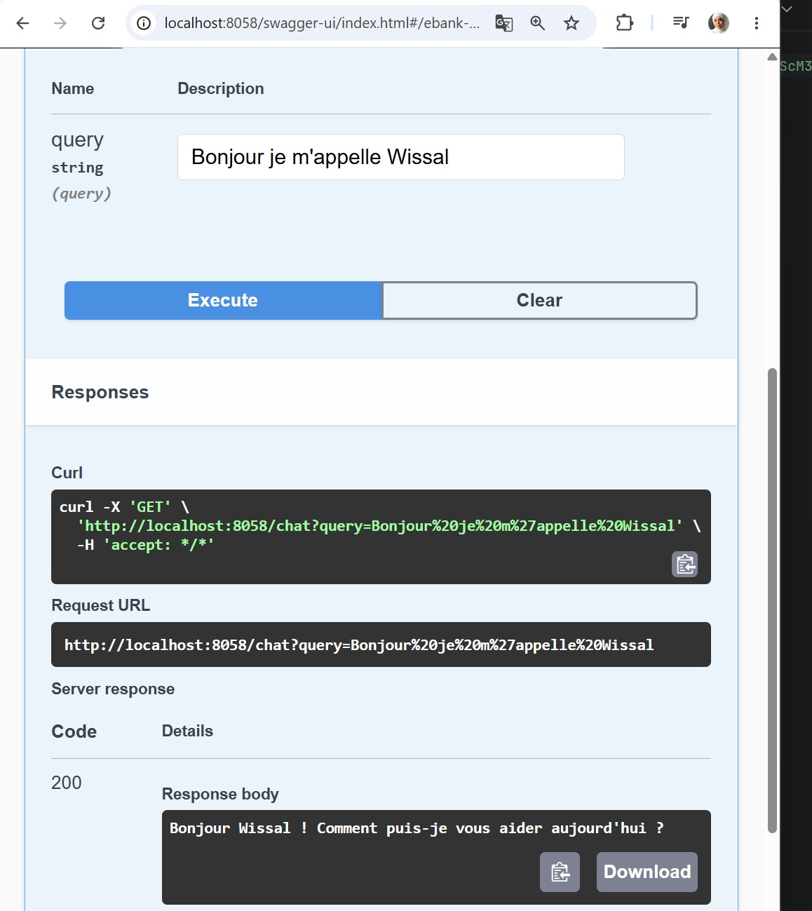
   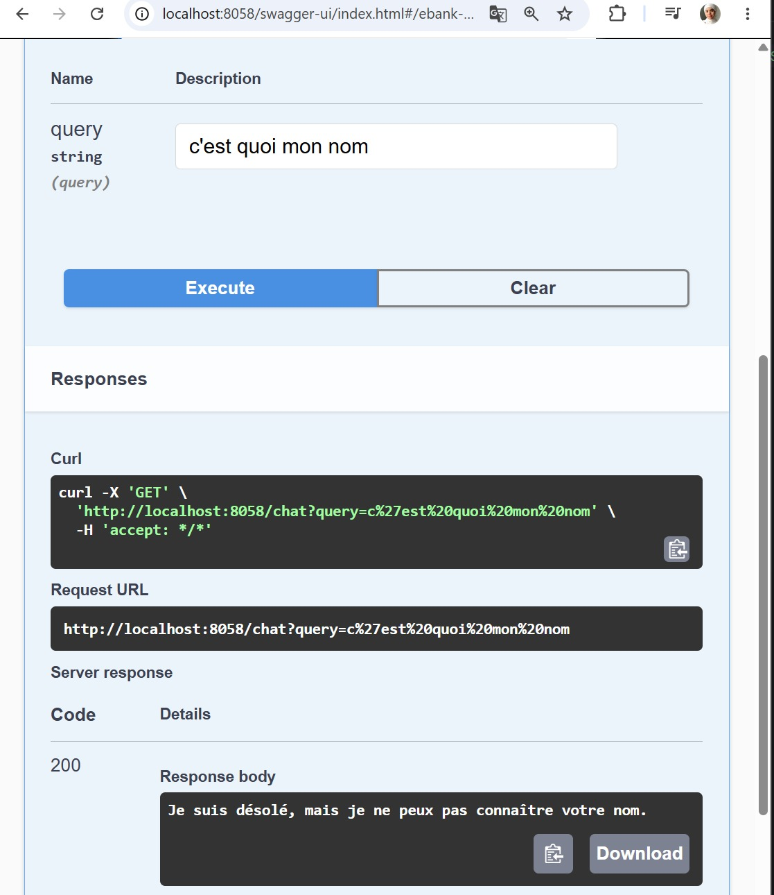

---

### B. Ajout de la Mémoire Contextuelle (`ChatMemory`)
Pour contourner la nature *stateless* du LLM, nous avons intégré un mécanisme de gestion de la mémoire conversationnelle (`ChatMemory`) au sein de l'agent IA.
- **Validation de la mémoire :** Après l'intégration de `ChatMemory`, l'agent retient le contexte de la conversation. Lorsque l'on réitère la question *"c'est quoi mon nom"*, l'agent s'en rappelle et répond avec succès : *"Votre nom est Wissal"*.

  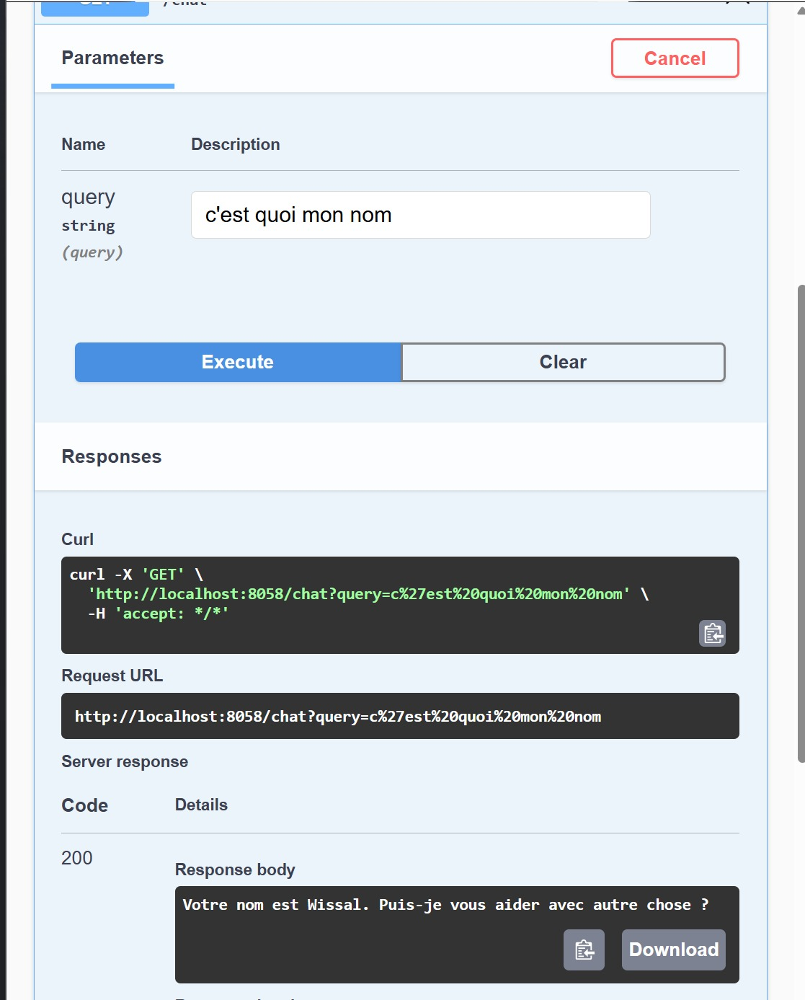

---

### C. Connexion via le Model Context Protocol (MCP)
Le protocole **MCP** est mis en œuvre pour connecter l'agent intelligent du bot (`ebank-bot` sur le port `8058`) aux micro-services métiers (`customer-service` et `ebank-service`), permettant à l'IA d'interagir dynamiquement avec les données bancaires et clients de l'application distribuée.

---

### D. Intégration et Tests des Clients Multi-Plateformes (Telegram et Discord)

1. **Client Telegram (`@eb_wissal_bot`) :**
    - Configuration et génération du token sécurisé via **BotFather**.
    - Le bot relaie les interactions en temps réel avec l'agent IA tout en gérant les indicateurs d'action de frappe (`ActionType.TYPING`).

   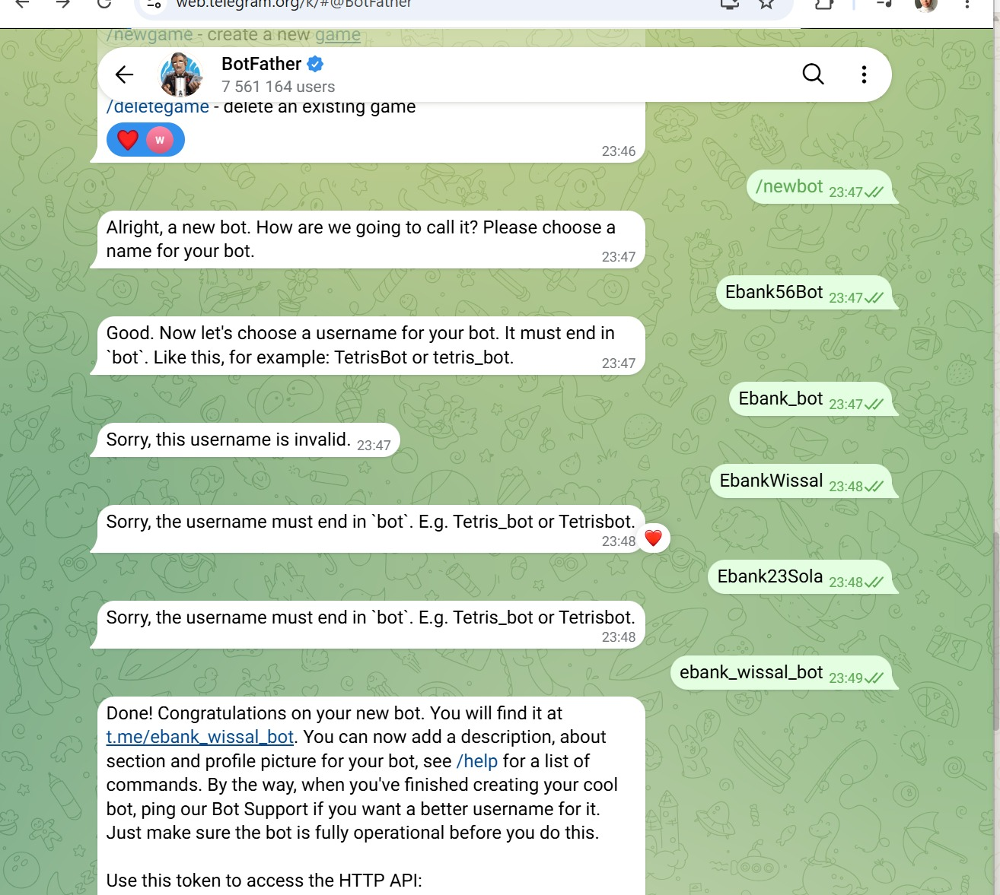

2. **Client Discord (`ebank-app`) :**
    - Enregistrement de l'application sur le portail développeur Discord et attribution des permissions d'interaction.
    - Ajout et autorisation du bot sur le serveur Discord personnel (*"Serveur de Wissal Biyi"*).

   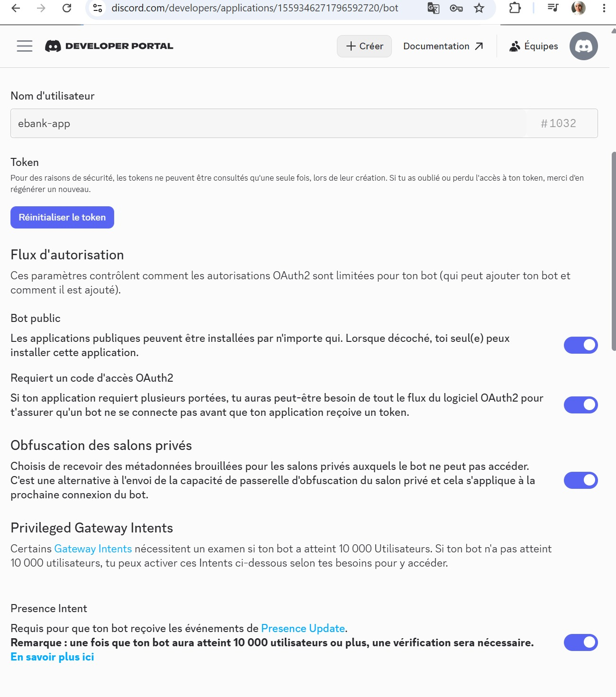
   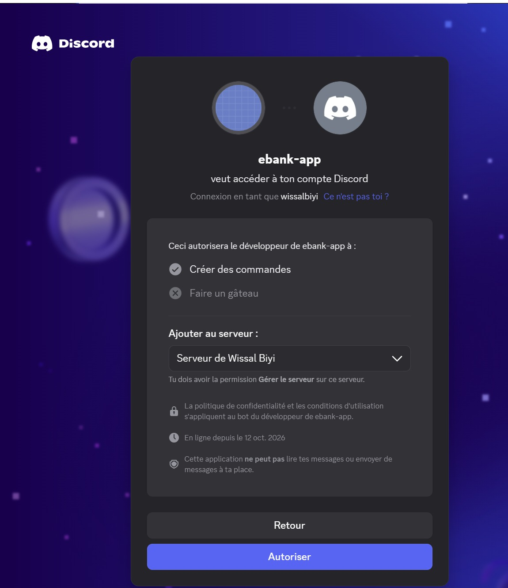
----
## 7. Conclusion de la Partie 2

Cette seconde partie a permis d'enrichir l'architecture microservices eBanking en y intégrant une couche d'intelligence artificielle générative moderne et performante. Grâce au couplage de **Spring AI** avec le modèle Grok et l'utilisation du protocole **MCP**, le chatbot est désormais capable d'interagir dynamiquement avec les données des différents services métiers.

L'implémentation de la mémoire conversationnelle (**`ChatMemory`**) a résolu la problématique inhérente au caractère *stateless* des LLM, garantissant ainsi un suivi contextuel fluide et personnalisé des échanges avec l'utilisateur. Enfin, le déploiement multi-plateforme à travers l'API REST (Swagger), le bot **Telegram** et l'intégration **Discord** démontre la robustesse, la flexibilité et l'interopérabilité de la solution distribuée mise en place.